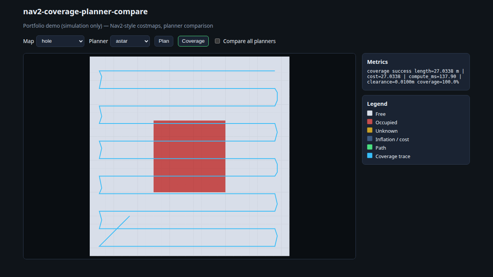

# nav2-coverage-planner-compare

**Portfolio demo, simulation only.** Single differential-drive robot on static occupancy grids — not a production Nav2 plugin, not field-tested on hardware, and not a claim of prior commercial deployment.

Compare **A\***, **Dijkstra**, **Lazy Theta\***, **RRT\***, and **boustrophedon coverage with stripe linking** on a simplified Nav2-style costmap (center-space inflation + optional soft costs). Includes a C++17 core, pybind11 tests, TypeScript browser port with parity fixtures, optional ROS 2 Humble wrapper, and GitHub Actions CI.

**Live demo (GitHub Pages):** [nav2-coverage-planner-compare](https://applycoding.github.io/nav2-coverage-planner-compare/)



## Features

- **Costmap:** PGM/YAML load, unknown policy, inflation (`robot_radius + margin`), segment collision on robot center (no double-counted footprint).
- **Global planners:** 8-connected cost-aware A* / Dijkstra, deferred-LOS Lazy Theta*, grid RRT* (iteration vs deadline modes).
- **Coverage:** lawn-mower stripes (`spacing = 2·r − overlap`), linker planner between components, reachable vs total coverage ratios.
- **Metrics:** path length, objective cost, clearance, coverage %, success reasons; `compute_ms` reported in benches only (never golden).
- **Parity:** `expected.json` goldens from `ncp_dump_fixture`, checked in C++ gtest, pytest, and Vitest.

## Architecture

```text
GridMap (PGM/YAML) → Costmap → Collision → GlobalPlanner / CoveragePlanner → Metrics
                                      ↘ pybind11 (ncp_core) | ROS 2 srv | TypeScript worker
```

## Quick start

### C++ tests (no ROS)

```bash
cmake -S . -B build -DCMAKE_BUILD_TYPE=Release -DCMAKE_CXX_COMPILER=g++
cmake --build build -j
ctest --test-dir build --output-on-failure
```

### Python parity + bench

```bash
PYTHONPATH=build/python python3 -m pytest -q python/tests
```

`PYTHONPATH` must point at `build/python` where `ncp_core` is built; optional `pip install -r python/requirements-dev.txt` for pytest 9.2.0.

### Web demo

```bash
cd web && npm ci && npm test && npm run build && npm run preview
```

Open `/nav2-coverage-planner-compare/` on the preview port (4173 in CI). Planning runs in a Web Worker.

### Optional ROS 2 Humble

ROS 2 **Humble** is used here for the optional `ncp_planner` wrapper only; upstream support continues through **May 2027**. A **Jazzy** port is future work and is not built in v1.

Build the core to a prefix (`cmake --install build --prefix install/ncp`), then `colcon build` in `ros2/` with `CMAKE_PREFIX_PATH`. See `ros2/ncp_planner/launch/planner.launch.py`. CI runs on PRs labeled `ci-ros`.

## Algorithms (teaching model)

- **Search:** One engine for A* (octile heuristic) and Dijkstra; diagonal corner-cutting forbidden.
- **Lazy Theta\*:** Deferred line-of-sight with parent repair ([Nash et al., AAAI 2010](https://idm-lab.org/bib/abstracts/papers/aaai10b.pdf)).
- **RRT\*:** xorshift32 RNG (shared golden vector in C++ and TS); fixture mode uses iteration cap only for deterministic goldens.
- **Coverage:** Axis-aligned stripes on the region AABB; partial plans do not teleport.

## Benchmarks (real run on this CI image class)

| Platform | Load map (ms) | A* search (ms) |
| --- | ---: | ---: |
| Linux/x86_64 py3.12, g++ 13 | 0.015 | 0.108 |

Regenerate: `PYTHONPATH=build/python pytest python/tests/test_bench.py -s`.

## License and attribution

Licensed under **Apache-2.0**. See [LICENSE](LICENSE) and [NOTICE](NOTICE).

**Idea references (no source copied):** PythonRobotics (MIT), Nav2 costmap/planner packages (Apache-2.0 / BSD-3-Clause), Fields2Cover (BSD-3-Clause), opennav_coverage (Apache-2.0), nobleo/full_coverage_path_planner (Apache-2.0), ngraph.path (MIT), javascript-astar (MIT), motion-planning/rrt-algorithms (MIT). **Idea-only (GPL/LGPL):** ethz-asl/polygon_coverage_planning, nav2_amcl.

All planner code in this repository was written for this demo; it is not a vendored fork.

**Author:** Arpan Bom ([applycoding@gmail.com](mailto:applycoding@gmail.com))
